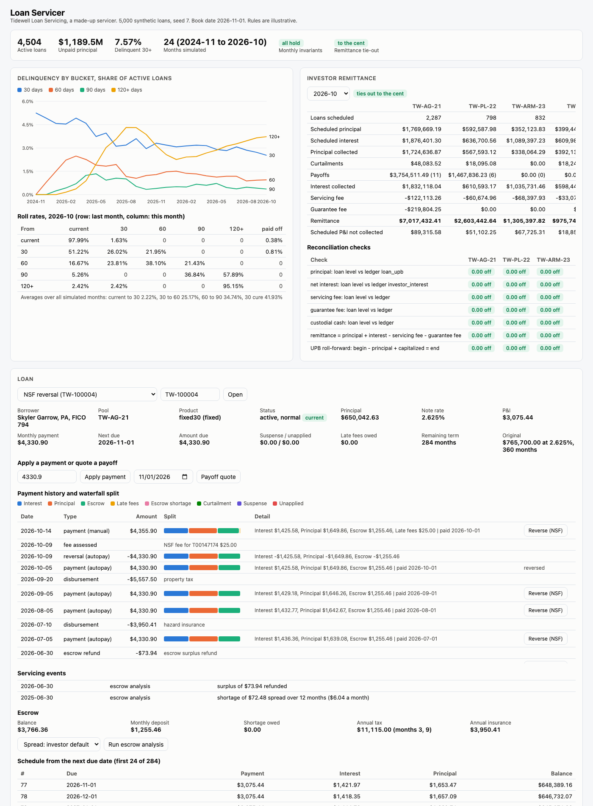

# Loan Servicer

A mortgage loan servicing core for Tidewell Loan Servicing, a made-up servicer. It covers what happens after a loan closes, month after month: exact amortization, ARM resets with caps, recasts and modifications, a payment waterfall with suspense and NSF reversal, delinquency buckets and a collections queue, annual escrow analysis, payoff quotes, and investor remittance that ties out to the loan-level ledger to the cent. Every amount is an integer number of cents and every rate an integer in thousandths of a percent; there are no floats in the money path. A seeded simulation runs 5,000 synthetic loans through 24 months and checks invariants at every month end.

This is an educational project. The servicing rules (waterfall orders, grace periods, fee amounts, escrow cushion and surplus handling, contact rules) are illustrative. They are not any agency's, investor's or regulator's actual guidelines.



## Simulation results (5,000 loans, 24 months, seed 7)

`uv run loanservicer simulate --months 24` (about 20 seconds on a laptop):

| Measure | Value |
|---|---|
| Monthly invariants | all hold: 120,000 loan-month checks, 0 failures |
| Remittance tie-out | 4 pools x 24 months, every check to the cent |
| Payments applied | 108,704 (229 NSF reversals, 14,462 late fees assessed) |
| Payoffs, recasts, modifications | 496, 73, 342 |
| ARM resets | 1,676 (626 limited by a cap: 360 initial, 266 periodic) |
| Escrow analyses | 8,154 (5,720 with a shortage, 1,313 surplus refunds) |
| Active loans at end | 4,504, UPB $1,189,476,809.01 |

Average monthly roll rates:

| Transition | Rate |
|---|---|
| current to 30 | 2.22% |
| 30 to 60 | 25.17% |
| 60 to 90 | 34.74% |
| 90 to 120+ | 77.67% |
| 30 back to current | 41.93% |
| 60 back to current | 6.61% |

Delinquency month by month (end of month, loans):

| Month | Current | 30 | 60 | 90 | 120+ |
|---|---|---|---|---|---|
| 2024-11 | 4,721 | 262 | 0 | 0 | 0 |
| 2025-04 | 4,421 | 223 | 110 | 60 | 43 |
| 2025-10 | 4,333 | 140 | 58 | 16 | 183 |
| 2026-04 | 4,281 | 146 | 56 | 28 | 124 |
| 2026-10 | 4,163 | 114 | 43 | 16 | 168 |

Honest notes on these numbers. The borrower behavior mix is chosen to exercise every path (partial payers, chronic delinquency, a 3% hardship cohort, NSF-prone autopay), so delinquency runs higher than a typical prime book: about 7.6% of loans are 30 or more days behind at the end. The 120+ bucket includes loans in forbearance, because buckets count contractual months behind. Most escrow analyses find a shortage because the simulation raises taxes by up to 6% and insurance by up to 14% a year. Seed 7 is the default I started with; I did not search for a seed that looks better.

## Why

A servicer holds other people's money in transit: borrower payments that belong partly to an investor, partly to a tax authority, partly to an insurer, and partly to the servicer as fees. Errors here are not abstract. A payment applied in the wrong order turns a one-time late fee into months of rolling delinquency. A returned check that is reversed naively leaves later payments misapplied. An escrow analysis that projects the wrong low point gives a borrower a surprise payment jump. And a monthly remittance that is off by a few cents means the servicer cannot prove where investor money went. This project shows the core that prevents those failures: one waterfall configurable per investor, LIFO unwinding for reversals, a balanced ledger behind every state change, and a reconciliation that ties loan-level activity to pool totals every month.

## Architecture

```
 synth.py: seeded loans, borrowers, escrow, 4 investor pools, synthetic rate index
        │
        ▼
 simulate.py  month loop ──────────────────────────────────────────────────────────────┐
   1st:  ARM resets (caps), forbearance start, modification, scheduled P&I per pool     │
   days: late fee check after grace │ payments │ NSF returns │ tax and insurance │ calls │
   end:  buckets, roll rates, plans, loss mit referral, escrow analysis                 │
        │                                                                               │
        ▼                                                                               │
 servicing.py  Servicer                                       ledger.py                 │
   apply_payment: waterfall by investor rules ──── posts ───▶ balanced lines per event  │
   reverse_payment: unwind later, reverse, reapply             per (loan, account)      │
   assess_late_fees, disburse, recast, modify_loan             per (pool, month, acct)  │
   payoff_quote / process_payoff                                     │                  │
        │                                                            ▼                  │
        ▼                                                  reporting.py                 │
 delinquency.py: DPD, buckets, roll rates, queue            remittance per pool         │
 escrow.py: projection, cushion, shortage/surplus           reconcile: loan level vs    │
 amortization.py: exact schedules, ARM caps, recast, mod    ledger vs UPB roll-forward  │
                                                                     │                  │
                                    invariants.py ◀──────────────────┘◀─────────────────┘
                                          │
                       FastAPI (app.py) + web UI, /healthz, /metrics, JSON logs, audit log
```

| Piece | File |
|---|---|
| Integer money, rounding, dates | `src/loanservicer/money.py` |
| Amortization, ARM caps, recast, modification | `src/loanservicer/amortization.py` |
| Loans, investor rules, transactions | `src/loanservicer/models.py` |
| Waterfall, suspense, NSF reversal, fees, payoff | `src/loanservicer/servicing.py` |
| Double-entry ledger | `src/loanservicer/ledger.py` |
| Delinquency, roll rates, collections queue | `src/loanservicer/delinquency.py` |
| Escrow analysis and notice | `src/loanservicer/escrow.py` |
| Remittance and reconciliation | `src/loanservicer/reporting.py` |
| Month-end invariants | `src/loanservicer/invariants.py` |
| Simulation and behavior model | `src/loanservicer/simulate.py`, `synth.py` |
| API, metrics, logs, CLI | `app.py`, `metrics.py`, `logs.py`, `cli.py` |
| Web UI (one HTML file, plain JS, light and dark) | `src/loanservicer/static/index.html` |

### Amortization and rounding

The level payment is `B * r / (1 - (1 + r)^-n)` computed exactly with `Fraction` and rounded half up to the cent. Each month's interest is the balance times the monthly rate, rounded half up. The final installment pays the remaining balance, so it can differ by a few cents. $200,000 at 6% for 360 months gives $1,199.10, and the tests check six standard table values. Interest-only loans pay interest only for the IO period, then amortize over the remaining term.

ARM resets use the index two months back plus the margin, rounded to the nearest 1/8%, then the initial or periodic cap, then the lifetime ceiling and the floor. The result records which limit applied. A recast keeps the rate and maturity and lowers the payment after a large curtailment. A modification capitalizes the missed interest and any escrow advance, waives late fees, and re-amortizes at the new rate and term.

### Payment waterfall

Each pool has `InvestorRules`: the order of late fees, escrow shortage, interest, principal and escrow; a partial payment policy; what to do with excess; grace days; fee sizes; servicing and guarantee fee rates; day count; escrow cushion and spread. The four pools use different settings:

| Pool | Order | Partials | Excess |
|---|---|---|---|
| TW-AG-21 | interest, principal, escrow, shortage, fees | suspense | curtailment |
| TW-PL-22 | fees, interest, principal, escrow, shortage | apply in order | pay ahead, then curtailment |
| TW-ARM-23 | shortage, interest, principal, escrow, fees | suspense | unapplied |
| TW-BAL | interest, principal, escrow, shortage, fees | suspense | curtailment |

Under the suspense policy, money that cannot cover a full installment (after any fees that come first) is held in suspense and released into the next payment. With fees first, a borrower who pays exactly the installment while owing a late fee lands in suspense; a test shows this, and it is why fees-last orders exist. Servicing fee and guarantee fee are stripped from each interest dollar collected, at fee rate over note rate.

### NSF reversal

Reversing a returned payment unwinds every later payment in reverse order, reverses the returned one, assesses the NSF fee, then applies the later payments again. A test checks that the result matches a book that never saw the bad payment. Reversals are allowed for 60 days and refused across a recast, modification or rate reset.

### Delinquency and collections

Buckets count contractual months behind: a loan due January 1 is "30" on January 31 and "60" on February 28. Late fees are assessed at the start of the day after the grace period, once per installment, never during forbearance or a payment plan. The queue ranks loans past grace by a transparent score (days past due, credit score, returned payments, broken plans, balance) and applies contact rules in order: bankruptcy stops contact, forbearance and loss mitigation go to that team, a cease request means letters only, and seven call attempts in seven days blocks calls until the window clears. At 60 days the action is a repayment plan offer; at 90 days a loss mitigation referral.

### Escrow and payoff

The analysis projects 12 months of disbursements, sets the deposit to one twelfth (rounded up), and walks the balance month by month from the current balance plus deposits owed on unpaid installments. Shortage below the cushion (capped at 1/6 of annual disbursements) is spread over the investor's months or collected as a lump sum. A surplus of $50 or more on a current loan is refunded. The notice preview states the new deposit and total payment.

A payoff quote charges interest daily from the start of the unpaid interest period to the payoff date (365 or 360 day basis), adds late fees, a release fee and any escrow advance, credits suspense and unapplied funds, and lists the total for the next few days. The escrow balance is refunded after payoff, not netted.

### Remittance and tie-out

Remittance is actual/actual: principal collected (scheduled, curtailments, payoffs) plus interest, less servicing and guarantee fees. Scheduled principal and interest sit beside it, so the uncollected amount (what a scheduled/scheduled servicer would advance) is visible. Each month, for each pool, `reconcile` checks loan-level transaction totals against the ledger for principal, net interest, servicing fee, guarantee fee and custodial cash; checks the remittance formula; and checks the UPB roll-forward (begin minus principal plus capitalized equals end). The invariants also check that no balance is negative, that each loan's ledger accounts equal its state, and that the ledger balances overall.

## How to run

Requires [uv](https://docs.astral.sh/uv/). Docker is optional; the Docker image is built and smoke tested in CI.

```bash
make install                                   # uv sync --python 3.12
make run                                       # http://127.0.0.1:8880 (simulates 24 months at startup, about 20 s)
uv run loanservicer simulate --months 24       # the report above
uv run loanservicer simulate --months 12 --strict   # exit 1 unless every invariant holds and remittance ties out
```

`LS_LOANS`, `LS_MONTHS` and `LS_SEED` change the startup book; `LS_AUDIT` sets the audit log path (default `var/audit.jsonl`).

API (book date is the day after the last simulated month):

```bash
curl -s localhost:8880/api/loans/TW-100004                    # detail, schedule, history with splits, escrow
curl -s -XPOST localhost:8880/api/loans/TW-100004/payments -H 'content-type: application/json' \
  -d '{"amount_cents": 433090}'
curl -s -XPOST localhost:8880/api/loans/TW-100004/payments/T00000001/reverse -H 'content-type: application/json' \
  -d '{"reason": "NSF"}'
curl -s 'localhost:8880/api/loans/TW-100004/payoff?payoff_date=2026-11-20'
curl -s 'localhost:8880/api/loans/TW-100001/escrow-analysis?spread=lump'
curl -s 'localhost:8880/api/collections?bucket=60'
curl -s 'localhost:8880/api/investor/remittance?month=2026-10'
curl -s 'localhost:8880/api/investor/reconciliation?month=2026-10'
curl -s localhost:8880/api/investor/delinquency
curl -s localhost:8880/api/roll-rates
curl -s localhost:8880/api/audit
curl -s localhost:8880/healthz
curl -s localhost:8880/metrics            # ls_loans_by_bucket, ls_remittance_ties_out, ls_payments_applied_total, latency
```

Amounts must be JSON integers of cents; `100.5` or `"100"` is rejected with 422. Logs are one JSON object per line with a request id echoed in `x-request-id`. Payments, reversals, payoff quotes, recasts and modifications are appended to the audit log.

## Tests

124 tests, all offline, in about 4 seconds:

```bash
make test        # uv run --python 3.12 --group dev pytest -q
make lint        # uvx ruff check . and ruff format --check
```

- **Amortization** (19): six standard payment values, schedules that pay to zero with principal summing to the balance, total interest, zero rate, interest-only then amortizing, half-up rounding, float rejection, month-end dates.
- **ARM, recast, modification** (13): 1/8 rounding, uncapped reset, initial, periodic (up and down) and lifetime caps, floor, reset dates, re-amortization at reset, recast keeps maturity, no recast during IO, capitalization of arrears and escrow advance with fee waiver.
- **Waterfall** (33): the split of an exact installment, four orders with fees outstanding, four orders under partial application, fees last, suspense hold and release, two installments at once, curtailment, pay ahead, unapplied funds, escrow shortage, fee strip, 12 randomized runs (6 seeds x 2 policies) that must split to the cent, bad inputs.
- **NSF reversal** (7): state restored with fee, LIFO unwind and reapply equal to a clean book, partial installment state under the apply policy, double reversal, window, recast barrier, late fee after reversal.
- **Delinquency and collections** (13): grace period edge (day 16 vs 17), payment on the last grace day, one fee per installment with cap, shorter grace, forbearance, months-behind convention, bucket path to 120+, cure, roll rate counts and rates, contact rules, grace exclusion, escalation.
- **Escrow and payoff** (13): cushion cap, shortage spread and lump sum, deficiency, surplus refund, small surplus kept, delinquent loan, notice, per diem on 365 and 360 bases with credits and fees, good-through table, payoff processing, escrow advance recovery.
- **Reporting and simulation** (13): remittance math, tie-out, a one-cent ledger break caught, roll-forward with capitalization, reversal netting, invariant checker, invariants and tie-out in every month of a 500 loan, 12 month run, every behavior present, no negative balances, roll matrix consistent with buckets, determinism, hardship to modification.
- **API** (13): health and UI, summary, loan detail, payment with audit file, float and string amounts rejected, reversal, payoff, escrow analysis, collections ordering and filter, investor reports, open-month reconciliation after API payments, roll rates, metrics.

## DevOps

- `.github/workflows/ci.yml`: lint and tests; an `invariants` job that simulates 12 months on 5,000 loans with `--strict`, writes the month table to the job summary, uploads the JSON, and fails unless every monthly invariant holds and every pool ties out to the cent; a Docker build with a container smoke test.
- `Dockerfile`: multi-stage uv build, slim runtime, non-root user, `/app/var` owned by that user for the audit log, `HEALTHCHECK` on `/healthz` with a start period that covers the startup simulation.
- `Makefile`: `install`, `test`, `lint`, `run`, `simulate`, `gate`, `screenshot`, `docker-build`.

## Production notes

- State lives in memory and the ledger keeps running balances. A real servicing system keeps the journal in a database with append-only entries, posts each payment in one transaction with the loan state change, and closes each month so later activity cannot change a reported remittance.
- Remittance here is actual/actual. Scheduled/scheduled pools need advance tracking (P&I and escrow advances), recovery when the borrower cures, and stop-advance rules; the "scheduled P&I not collected" line is where that would start.
- Rules are code-level settings per pool. In production they come from investor guides through a versioned rules store, with effective dates, and changes are replayed against recent activity before release, the same way the reversal tests compare against a clean book.
- The simulation runs at startup for a demo. At scale the month-end steps (fee assessment, escrow analysis, remittance) are batch jobs partitioned by pool, with the invariant checks as gates before files go to investors.
- Collections contact rules and notice content are regulated (call frequency, time of day, required disclosures, language). Real rules come from compliance, and every contact attempt and notice is recorded for audit.
- Payment rails (ACH returns, lockbox files, wires) bring their own failure modes: duplicate files, late returns past the window, partial batches. Each would get an idempotency key and a reconciliation against the bank statement.

## License

MIT. See [LICENSE](LICENSE).
